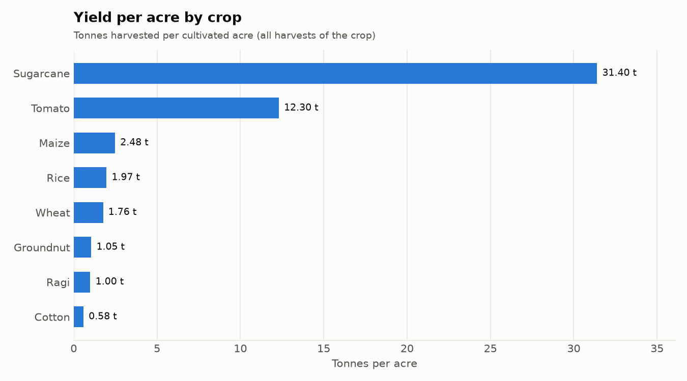
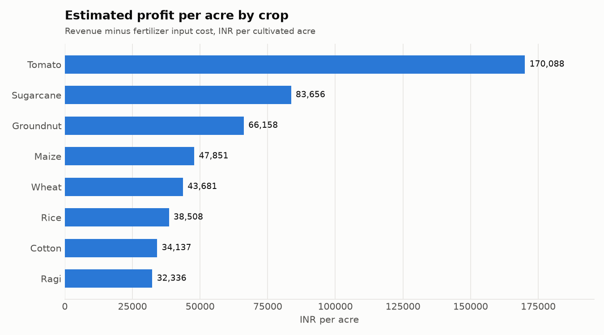

# Agriculture Crop Management and Yield Analysis System

**Scenario 29 - Register Nos. 29, 59, 89, 119**

A Java + SQL + Python project that manages farmers, farms, crops, cultivation, fertilizer inputs, irrigation and harvests, calculates productivity and profit, and visualizes crop performance.

## Features
- Manage farmers, farms and crops (add, view, update contact, delete)
- Register cultivation (farm, crop, date, area, season) with area and date validation
- Track fertilizer inputs (type, quantity, cost, date) and irrigation (date, water, method)
- Record harvest (date, quantity, quality A/B/C, selling price)
- Calculate **yield per acre, total input cost, revenue and estimated profit**
- Reports: crop-wise yield, farm-wise production, input costs, seasonal summary
- Python analytics: data retrieval, preprocessing and 8 charts

## Technologies
| Part | Technology |
|---|---|
| Application | Java 17, Maven, JDBC |
| Database | SQLite (SQL scripts included) |
| Analytics | Python 3, pandas, matplotlib |
| Testing | JUnit 5 |
| Diagrams | Graphviz (DOT sources included) |

## Repository structure
```
agri-crop-system/
├── README.md
├── docs/
│   ├── SRS.md  (and SRS.docx)
│   ├── Test_Cases.md
│   ├── Normalization.md        relational model + 1NF/2NF/3NF/BCNF
│   └── diagrams/               use case, class (2), ER, architecture  (.png + .dot source)
├── java-app/                   Maven project
│   ├── pom.xml
│   └── src/main/java/com/agri/ {model, dao, service, util, Main.java}
│   └── src/test/java/com/agri/ {CalculatorTest, InputHelperTest, ServiceIntegrationTest}
├── database/
│   ├── schema.sql              tables, constraints, view
│   ├── sample_data.sql         synthetic sample data (8 farmers ... 25 harvests)
│   ├── queries.sql             10 reporting queries
│   └── setup_db.py             builds agri.db from the two scripts above
├── python-analysis/
│   ├── analysis.py             retrieve + preprocess + visualize
│   ├── charts/                 8 PNG charts
│   └── output/                 cleaned CSV and crop summary
└── sample-output/              sample_input.txt, Python console output, Java output
```

## Prerequisites
- JDK 17 or newer (`java -version`)
- Maven 3.8+ (`mvn -v`)
- Python 3.9+ with pandas and matplotlib: `pip install pandas matplotlib`

No database server is needed: the database is a single SQLite file (`database/agri.db`).

## 1. Database setup
From the repository root:
```
python database/setup_db.py
```
This creates `database/agri.db` with the 7 tables, the view `v_cultivation_summary` and the sample data. Run it again any time to reset the database.

To run the reporting queries yourself, use `database/queries.sql` in any SQLite tool (DB Browser for SQLite, VS Code SQLite extension, or the `sqlite3` command line).

## 2. Run the Java application
```
cd java-app
mvn compile exec:java
```
The app finds `../database/agri.db` automatically (it also works when started from the repository root). A numbered menu appears:

```
 1. Add farmer                       8. View records
 2. Add farm                         9. Productivity and profit of a cultivation
 3. Add crop                        10. Reports
 4. Register cultivation            11. Update farmer contact number
 5. Add fertilizer input            12. Delete farmer
 6. Record irrigation               13. Load sample data (empty database only)
 7. Record harvest                   0. Exit
```
Input is validated: wrong numbers, dates, phone numbers or unknown IDs are rejected with a message and you are asked again.

**Run the demo script and save the output** (run `python database/setup_db.py` first so the IDs match):

Windows Command Prompt:
```
mvn -q compile exec:java -Dagri.echo=true < ..\sample-output\sample_input.txt > ..\sample-output\java_sample_output.txt
```
Windows PowerShell:
```
Get-Content ..\sample-output\sample_input.txt | mvn -q compile exec:java "-Dagri.echo=true" | Out-File ..\sample-output\java_sample_output.txt
```
Linux / macOS:
```
mvn -q compile exec:java -Dagri.echo=true < ../sample-output/sample_input.txt > ../sample-output/java_sample_output.txt
```

## 3. Run the Java tests
```
cd java-app
mvn test
```
Runs `CalculatorTest`, `InputHelperTest` and `ServiceIntegrationTest` (the last one builds a temporary database from `database/schema.sql` and `sample_data.sql`).

## 4. Run the Python analysis
From the repository root (after step 1):
```
python python-analysis/analysis.py
```
It retrieves the data from the database, preprocesses it (duplicates, types, dates, unharvested cultivations, per-acre measures, per-crop indexes), prints a crop-wise summary and saves:

| Chart | Shows |
|---|---|
| `1_yield_per_acre_by_crop.png` | Yield per acre by crop |
| `2_input_cost_per_acre_by_crop.png` | Fertilizer cost per acre by crop |
| `3_profit_per_acre_by_crop.png` | Estimated profit per acre by crop |
| `4_seasonal_profit.png` | Profit by season |
| `5_farm_wise_profit.png` | Profit by farm |
| `6_input_cost_vs_yield.png` | Fertilizer cost vs yield (relative to each crop's average) |
| `7_water_vs_yield.png` | Irrigation water vs yield (relative to each crop's average) |
| `8_quality_by_category.png` | Harvest quality mix by crop category |

Charts go to `python-analysis/charts/`, cleaned data to `python-analysis/output/`.




## Formulas
```
yield per acre   = quantity harvested (kg) / cultivated area (acres)
total input cost = sum of fertilizer input costs of the cultivation
revenue          = quantity harvested (kg) x selling price (INR per kg)
estimated profit = revenue - total input cost
```
Profit counts fertilizer input cost only (the input tracked in this scenario); labour, seed and machinery costs are not included.

## Documents
- [SRS](docs/SRS.md) - requirements, use cases, validation rules, traceability
- [Normalization and relational model](docs/Normalization.md)
- [Test cases](docs/Test_Cases.md)
- Diagrams: `docs/diagrams/` (use case, class diagrams, ER diagram, architecture)

## Notes
- The sample data in `database/sample_data.sql` is **synthetic** (generated for demonstration), not real farm records.
- Units: acres, kg, litres, INR.
- Diagram sources are Graphviz `.dot` files; re-create the PNGs with `dot -Tpng file.dot -o file.png`.
