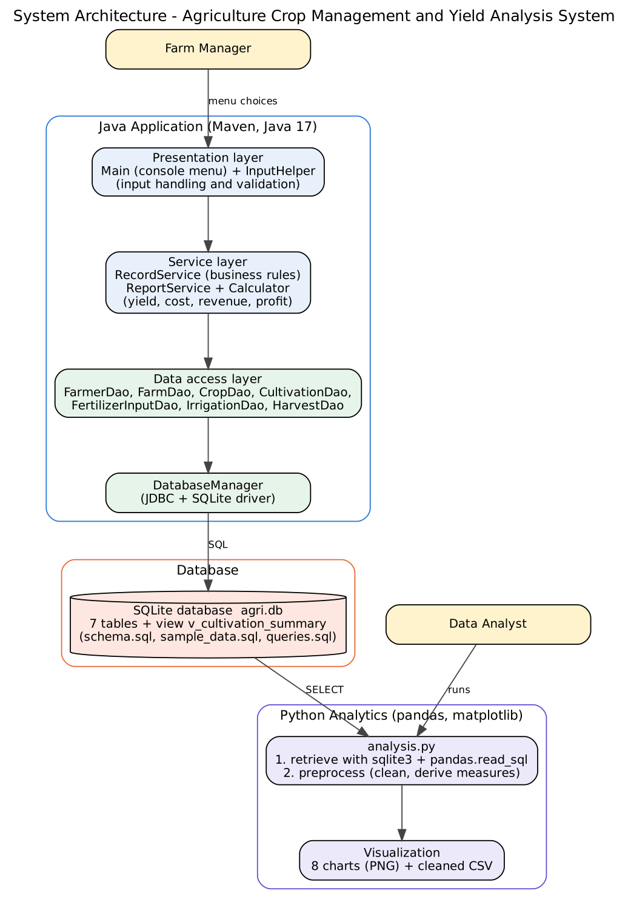
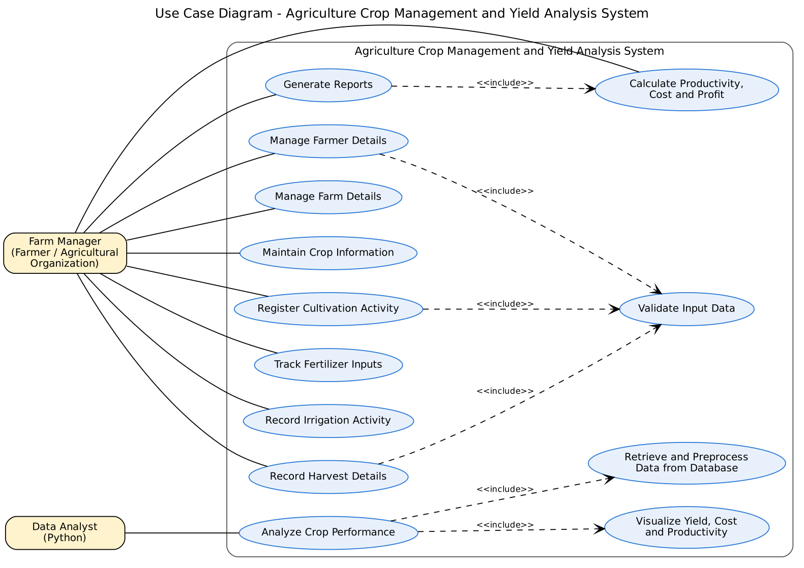
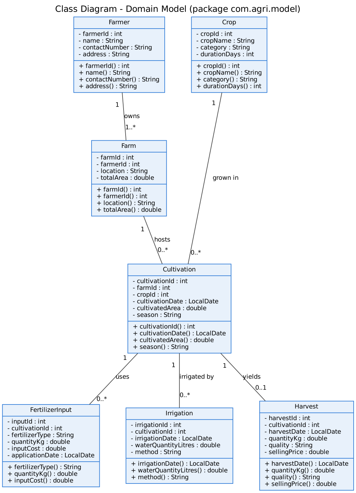
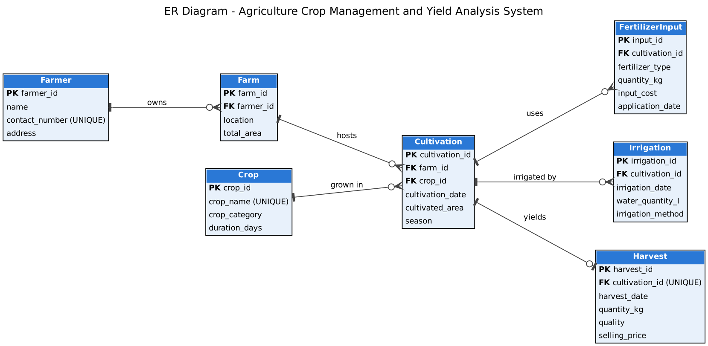

# Software Requirements Specification (SRS)

**Project:** Agriculture Crop Management and Yield Analysis System
**Scenario:** 29 (Register Nos. 29, 59, 89, 119)
**Version:** 1.0

---

## 1. Introduction

### 1.1 Purpose
This document specifies the requirements of the Agriculture Crop Management and Yield Analysis System. The system helps farmers and agricultural organizations record farm, crop, input and harvest data, calculate productivity and profit, and analyse which crops and practices give better yields.

### 1.2 Problem statement
Keeping cultivation records on paper makes it hard to compare crop productivity, monitor input costs and see what is associated with higher yields. The system replaces manual records with a database-backed Java application and a Python analytics module.

### 1.3 Scope
The system will:
- store farmer, farm, crop, cultivation, fertilizer input, irrigation and harvest records (Java + SQL database);
- calculate yield per unit area, total input cost, sales revenue and estimated profit;
- produce crop-wise, farm-wise, input-cost and seasonal reports;
- retrieve the data with Python, preprocess it and visualize yield, cost and productivity patterns.

Out of scope: weather data, labour/machinery costs, multi-user login, a graphical or web interface, and payments.

### 1.4 Definitions
| Term | Meaning |
|---|---|
| Cultivation | One crop grown on one farm in one season (one planting) |
| Yield per acre | Quantity harvested (kg) / cultivated area (acres) |
| Input cost | Money spent on fertilizer for a cultivation (INR) |
| Revenue | Quantity harvested x selling price per kg |
| Estimated profit | Revenue - total input cost |
| Season | Kharif, Rabi or Summer |
| DAO | Data Access Object - Java class that talks to one table |

### 1.5 Technologies
Java 17, Maven, JDBC, SQLite (SQL), Python 3 (pandas, matplotlib), Git/GitHub.

---

## 2. Overall description

### 2.1 Product perspective
A three-part system sharing one database:

1. **Java console application** - data entry, validation, calculations, reports.
2. **SQLite database** - 7 tables and one view (`v_cultivation_summary`).
3. **Python analytics script** - reads the same database and creates charts.

See `diagrams/architecture_diagram.png`.



### 2.2 User classes
| User | Description |
|---|---|
| Farm manager (farmer / organization staff) | Enters records, views reports, checks productivity and profit |
| Data analyst | Runs the Python script and interprets the charts |

### 2.3 Operating environment
Windows, Linux or macOS; JDK 17+, Maven 3.8+, Python 3.9+; no database server needed (SQLite file).

### 2.4 Assumptions and constraints
- Area is in **acres**, quantities in **kg**, water in **litres**, money in **INR**.
- One harvest is recorded per cultivation.
- Profit counts **fertilizer input cost only** (the scenario's tracked agricultural input); other costs are out of scope.
- Dates use the format `yyyy-MM-dd`.

---

## 3. Functional requirements

| ID | Requirement | Details |
|---|---|---|
| FR1 | Manage farmer details | Add, view, update contact number, delete farmer. Fields: farmer ID, name, contact number (10 digits, unique), address |
| FR2 | Manage farm details | Add and view farms. Fields: farm ID, farmer ID, location, total cultivated area (> 0) |
| FR3 | Maintain crop information | Add and view crops. Fields: crop ID, crop name (unique), category (Cereal, Pulse, Oilseed, Cash Crop, Vegetable, Millet), expected duration in days |
| FR4 | Register cultivation | Fields: farm, crop, cultivation date, cultivated area (<= farm total area), season |
| FR5 | Track agricultural inputs | Fields: fertilizer type, quantity (kg), input cost (INR), application date (not before cultivation date) |
| FR6 | Record irrigation | Fields: irrigation date, water quantity (litres), method (Drip, Sprinkler, Flood, Furrow) |
| FR7 | Record harvest details | Fields: harvest date, quantity harvested (kg), quality category (A, B, C), selling price (INR/kg); one harvest per cultivation |
| FR8 | Calculate productivity and costs | Yield per acre, total input cost, sales revenue, estimated profit for any cultivation |
| FR9 | Generate reports | Crop-wise yields, farm-wise production, agricultural input costs, seasonal harvest summaries |
| FR10 | Analyze crop performance | Python retrieves cultivation and harvest data from the database, preprocesses it and visualizes yield patterns, cost comparisons and productivity |

### 3.1 Calculation rules
```
yield per acre   = quantity harvested (kg) / cultivated area (acres)
total input cost = sum of input costs of the cultivation
revenue          = quantity harvested (kg) x selling price (INR per kg)
estimated profit = revenue - total input cost      (negative value = loss)
```

### 3.2 Validation rules
| ID | Rule |
|---|---|
| VR1 | Mandatory text fields (name, address, location, fertilizer type) cannot be empty |
| VR2 | Contact number: exactly 10 digits, first digit 6-9, unique per farmer |
| VR3 | Areas, quantities, water and selling price must be greater than 0; input cost cannot be negative |
| VR4 | Dates must be valid and in `yyyy-MM-dd` format |
| VR5 | Referenced farmer / farm / crop / cultivation IDs must exist |
| VR6 | Cultivated area cannot exceed the farm's total area |
| VR7 | Input, irrigation and harvest dates cannot be before the cultivation date |
| VR8 | Season, irrigation method, crop category and quality must be one of the allowed values |
| VR9 | A cultivation can have only one harvest |

---

## 4. Use cases



| Use case | Actor | Main flow |
|---|---|---|
| UC1 Manage farmer details | Farm manager | Choose menu option, enter details, system validates and saves |
| UC2 Manage farm details | Farm manager | Select farmer, enter location and area, save |
| UC3 Maintain crop information | Farm manager | Enter crop name, category, duration, save |
| UC4 Register cultivation | Farm manager | Select farm and crop, enter date, area, season; system checks area rule |
| UC5 Track fertilizer inputs | Farm manager | Select cultivation, enter type, quantity, cost, date |
| UC6 Record irrigation | Farm manager | Select cultivation, enter date, water quantity, method |
| UC7 Record harvest | Farm manager | Select cultivation, enter date, quantity, quality, price |
| UC8 Calculate productivity and profit | Farm manager | Select cultivation; system shows yield, cost, revenue, profit |
| UC9 Generate reports | Farm manager | Choose report; system prints table |
| UC10 Analyze crop performance | Data analyst | Run Python script; it retrieves, preprocesses and plots data |

Alternate flow for UC1-UC7: if validation fails the system shows an error message and no record is saved.

---

## 5. Design overview

- **Class diagrams:** `diagrams/class_diagram_domain.png` (entities) and `diagrams/class_diagram_application.png` (Main, services, DAOs, utilities).
- **ER diagram:** `diagrams/er_diagram.png`, relational model in `Normalization.md`.
- **Architecture:** layered (Presentation -> Service -> DAO -> JDBC -> SQLite), with Python reading the same database.





---

## 6. Non-functional requirements

| ID | Requirement |
|---|---|
| NFR1 | **Usability** - numbered console menu, clear prompts, input is re-requested until valid |
| NFR2 | **Reliability / integrity** - primary keys, foreign keys, CHECK and UNIQUE constraints in the database; ON DELETE CASCADE keeps records consistent |
| NFR3 | **Performance** - any menu action or report completes in under 2 seconds for up to ~10,000 records |
| NFR4 | **Portability** - runs on any OS with Java 17 and Python 3; no database server |
| NFR5 | **Maintainability** - layered code (model, dao, service, util), one class per table, unit tests |
| NFR6 | **Security** - all SQL uses prepared statements (no SQL injection); only whitelisted table names are listed dynamically |
| NFR7 | **Data quality** - Python preprocessing removes duplicates and invalid rows, and keeps unharvested cultivations out of yield statistics |

---

## 7. Requirement traceability

| Requirement | Java class / method | SQL | Python | Test cases |
|---|---|---|---|---|
| FR1 | `RecordService.addFarmer`, `updateFarmerContact`, `deleteFarmer`, `FarmerDao` | `Farmer` | - | TC-01 to TC-06 |
| FR2 | `RecordService.addFarm`, `FarmDao` | `Farm` | - | TC-07 |
| FR3 | `RecordService.addCrop`, `CropDao` | `Crop` | - | TC-08 |
| FR4 | `RecordService.registerCultivation`, `CultivationDao` | `Cultivation` | - | TC-09 to TC-11 |
| FR5 | `RecordService.addFertilizerInput`, `FertilizerInputDao` | `FertilizerInput` | - | TC-12 |
| FR6 | `RecordService.addIrrigation`, `IrrigationDao` | `Irrigation` | - | TC-13 |
| FR7 | `RecordService.addHarvest`, `HarvestDao` | `Harvest` | - | TC-14, TC-15 |
| FR8 | `Calculator`, `ReportService.calculate` | `v_cultivation_summary` | derived columns | TC-16 to TC-20 |
| FR9 | `ReportService` report methods, `TablePrinter` | `queries.sql` Q1-Q4 | - | TC-21 to TC-24 |
| FR10 | - | `v_cultivation_summary` | `analysis.py` | TC-30 to TC-33 |
